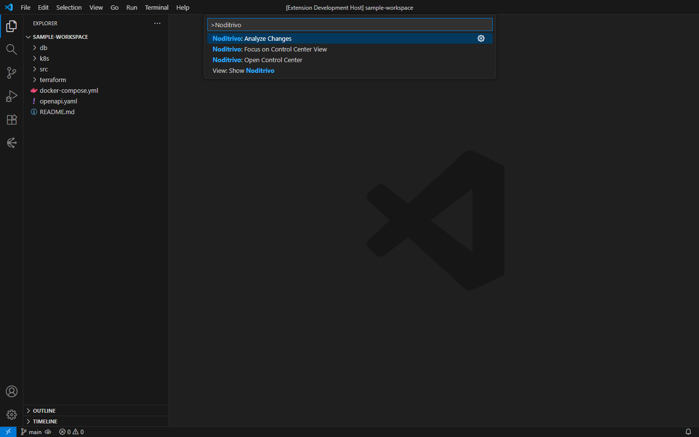
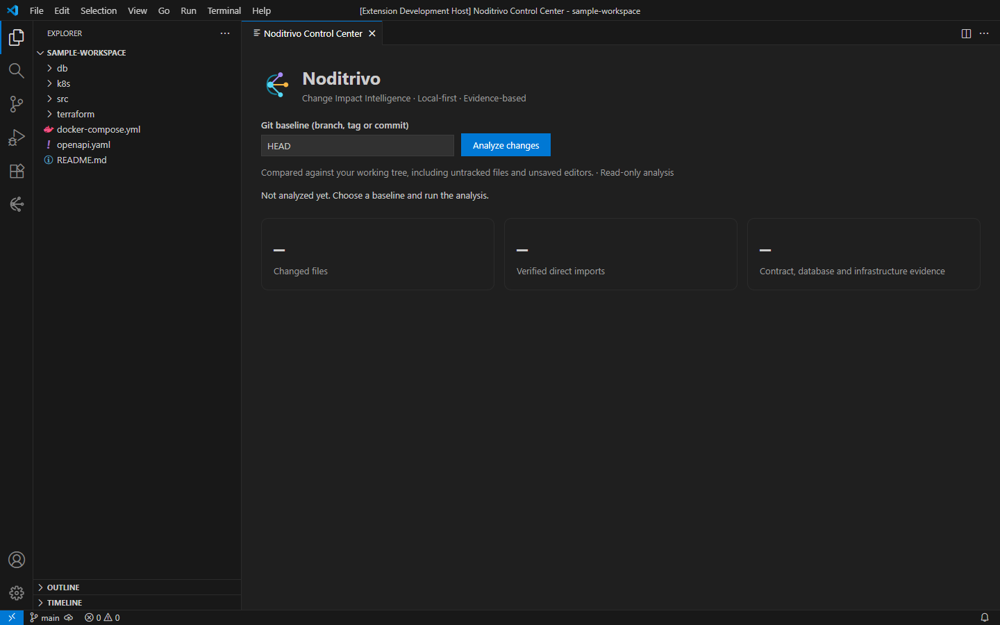
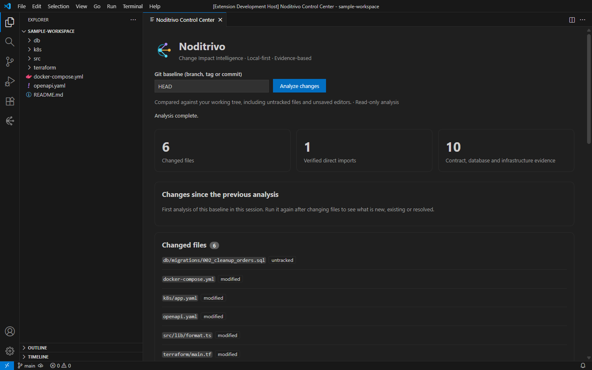
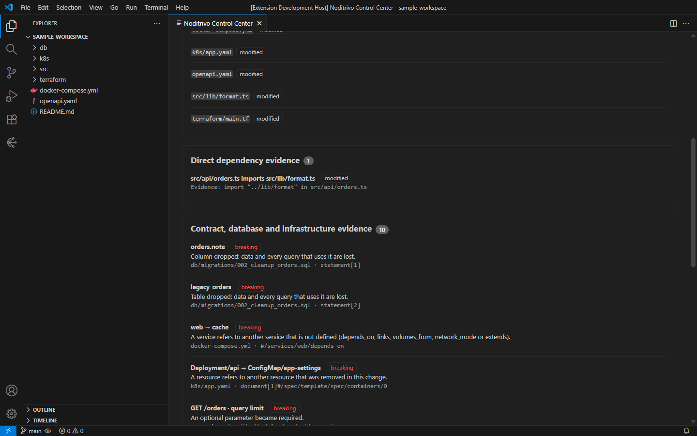
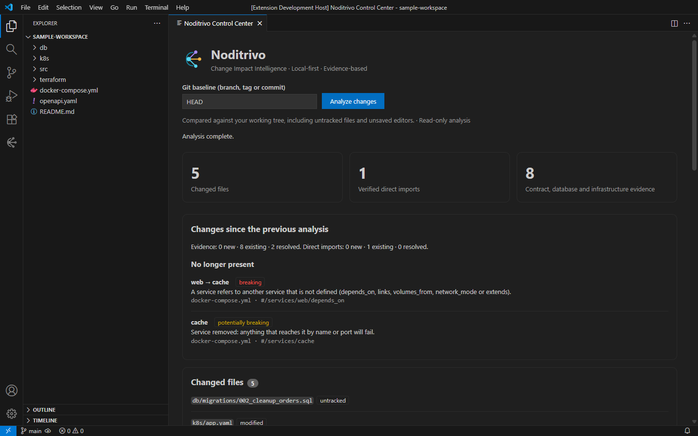
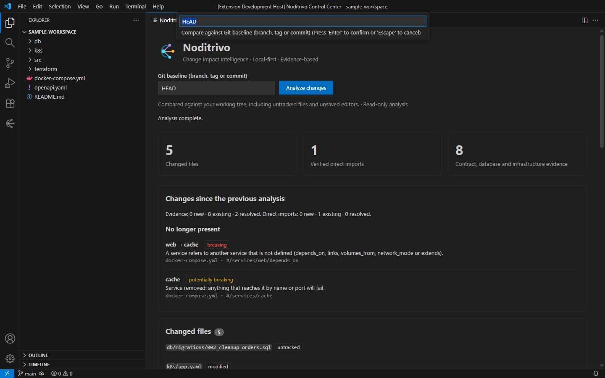

# Noditrivo

**Change Impact Intelligence** · *Know what changes before it breaks.*

Local-first VS Code extension for evidence-based impact analysis across code, APIs, databases and infrastructure.

> **Pre-release (0.1.0), not published.** Compares your working tree with a Git baseline and reports evidence from direct JS/TS imports, OpenAPI breaking changes, SQL migrations, Docker Compose, Kubernetes and Terraform files. Every analyzer is static and limited to the changed files; the scope is shown in the Control Center. After a second run it also shows which findings are new, existing or resolved. Name subject to formal trademark clearance.

## Brand identity

The approved **Noditrivo Dark Premium** direction, logo variations, color values, typography, Activity Bar icon and Control Center UX specification are documented in [Brand Identity](docs/BRAND_IDENTITY.md).


- [Main symbol](media/brand/noditrivo-symbol.svg)
- [Dark-background logo](media/brand/noditrivo-logo-dark.svg) ([PNG for the README](media/brand/noditrivo-logo-dark.png), the Marketplace rejects SVG images there) / [Light-background logo](media/brand/noditrivo-logo-light.svg)
- [Monochrome VS Code Activity Bar SVG](media/brand/noditrivo-activity-bar.svg) — referenced in `package.json`; click the icon to open the Control Center in the central editor.
- [Design tokens](media/brand/tokens.css)

**Visual status:** SVGs are editable reconstructions; the original moodboard raster file is not yet stored in this repository. Production PNG exports and screenshots of the final running UI remain to be added and visually validated.

## What it looks like

Run **Noditrivo: Open Control Center** or **Noditrivo: Analyze Changes** from the Command Palette:



*The extension contributes two commands and no background activity.*

The Control Center opens in the main editor area, ready to compare the working tree with a Git baseline:



*Idle state: choose a baseline (default `HEAD`) and run the analysis. Read-only.*

After the analysis it summarizes the changed files, direct imports and contract, database and infrastructure evidence:



*Overview of a sample workspace with Compose, Kubernetes, Terraform, OpenAPI and SQL changes.*



*Every finding names the rule, the file and the exact location it comes from.*

Running the analysis again compares it with the previous one:



*New, existing and resolved evidence between two runs of the same baseline.*

The command also accepts a baseline straight from the Command Palette:



*`Noditrivo: Analyze Changes` prompts for a branch, tag or commit.*

## Getting started (development)

```bash
npm install
npm run check      # build + tests
npm run bench      # synthetic performance benchmark
npm run package    # check + VSIX + smoke test of the VSIX (does not publish)
```

### Regenerating the screenshots

```bash
npm run screenshots
```

The script (`scripts/capture-readme-screenshots.cjs`) builds the extension, downloads a pinned VS Code into `.vscode-test/` (git-ignored, override with `NODITRIVO_VSCODE_VERSION`), and launches it with the extension under development, a temporary profile (dark theme, 1440×900, 100 % zoom) and a throwaway Git repository created from `demo/`. It drives the real UI with `playwright-core`, writes the PNG files to `docs/images/` (each must stay under 300 KB) and deletes the temporary profile and workspace on exit. It needs a desktop session and network access the first time. The window title keeps the `[Extension Development Host]` prefix that VS Code adds when loading an extension under development.

`demo/sample-workspace/` is the baseline commit; `demo/sample-workspace-edits/step-1` and `step-2` are the working-tree edits applied before the first and second analysis.

Images are referenced with relative paths. `docs/images/` and `demo/` are excluded from the VSIX (`.vscodeignore`); `vsce` rewrites relative README image links to absolute URLs built from the `repository` field in `package.json`, so the files must exist on the repository's default branch when the extension is published (or pass `--baseImagesUrl`).

Security design: [Threat model](docs/THREAT_MODEL.md). Release steps: [Release readiness](docs/RELEASE.md).

Open this repository in VS Code, press **F5** to launch an Extension Development Host, open a project with Git changes and run **Noditrivo: Analyze Changes** in the Command Palette. The Control Center opens in the main editor area.

Use `HEAD` as baseline for tracked working-tree changes. You can provide another Git ref for comparisons. Untracked files and unsaved editors are included; aliases and transitive relations are not covered.

## Privacy & safety

- Read-only by design. The extension does not write repository files, modify databases, deploy infrastructure or send code to hosted models.
- No shell invocation for Git; inputs are validated.
- Every displayed dependency reports its source evidence and clear limitations.
- No claim of runtime failure is inferred from an import alone.

## Roadmap

See [Master Plan](docs/ENTERPRISE_AAAA_MASTER_PLAN.md) and [Upgrade Checklist](docs/ENTERPRISE_AAAA_UPGRADE_CHECKLIST.md). Do not publish or merge until the verification gates are satisfied.

## License

MIT. Developed by Alejandro Di Stefano — [ArmoTuSitio](https://armotusitio.com.ar).
